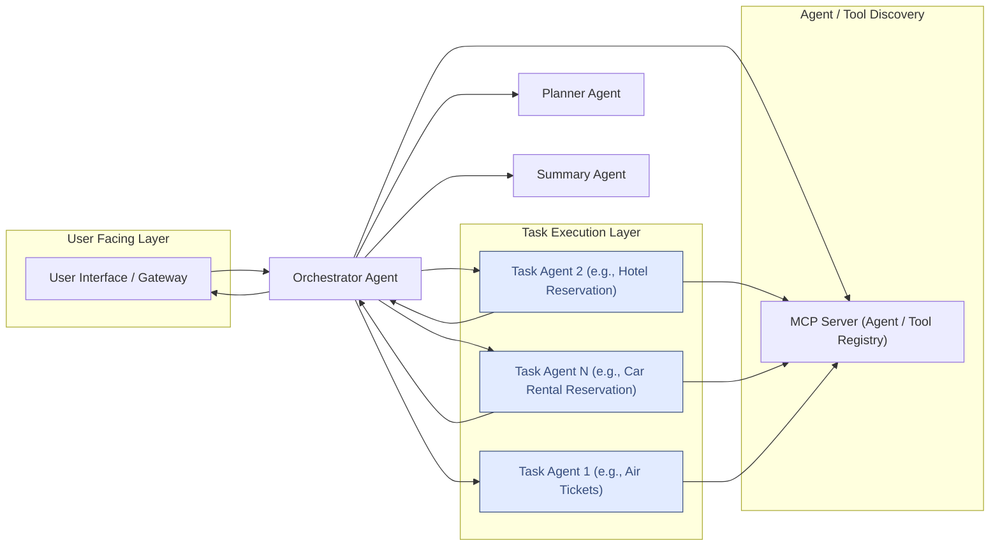

# A2A-MCP Multi-Agent System

**Leveraging Model Context Protocol (MCP) as a standardized mechanism for discovering and retrieving Google A2A Agent Cards, enabling dynamic agent interaction using A2A.**

A production-ready framework for building sophisticated multi-agent systems with seamless tool integration, dynamic agent discovery, and enterprise-grade security.

**🎯 Framework Standards**: This project follows the [A2A-MCP Unified Framework V2.0](A2A_MCP_UNIFIED_FRAMEWORK_V2.md) for standardized multi-agent architecture patterns, including Oracle, Service, and Research agent implementations.

## Table of Contents

- [A2A-MCP Multi-Agent System](#a2a-mcp-multi-agent-system)
  - [Table of Contents](#table-of-contents)
  - [🌟 Overview](#-overview)
  - [✨ Key Features](#-key-features)
  - [🚀 Quick Start](#-quick-start)
    - [Prerequisites](#prerequisites)
    - [Installation](#installation)
    - [Configuration](#configuration)
    - [Running the System](#running-the-system)
  - [🏗️ Architecture](#-architecture)
    - [Three-Tier Agent System](#three-tier-agent-system)
    - [Communication Flow](#communication-flow)
    - [Available Systems](#available-systems)
  - [🔐 Security](#-security)
    - [Environment Variables](#environment-variables)
    - [API Key Management](#api-key-management)
  - [📚 Documentation](#-documentation)
  - [🧪 Testing](#-testing)
  - [🛠️ Development](#-development)
  - [❓ Troubleshooting](#-troubleshooting)
  - [Background](#background)
    - [A2A Protocol](#a2a-protocol)
    - [Model Context Protocol (MCP)](#model-context-protocol-mcp)
  - [Core Proposal](#core-proposal)
    - [Storing Agent Cards](#storing-agent-cards)
    - [Discovering Agents via MCP](#discovering-agents-via-mcp)
    - [Retrieving Agent Cards](#retrieving-agent-cards)
    - [Finding an Agent for a Task](#finding-an-agent-for-a-task)
    - [Initiating A2A Communication](#initiating-a2a-communication)
  - [Use Case: Orchestrated Task Execution](#use-case-orchestrated-task-execution)
    - [Core Concepts](#core-concepts)
    - [Architectural Components](#architectural-components)
  - [Example Flow: Travel Agent](#example-flow-travel-agent)
  - [Implementation Guide](#implementation-guide)
    - [File/Directory Descriptions](#filedirectory-descriptions)

## 🌟 Overview

A2A-MCP is a sophisticated multi-agent system that demonstrates how autonomous AI agents can collaborate to solve complex tasks through standardized communication protocols. The system combines:

- **Agent-to-Agent (A2A) Protocol**: JSON-RPC based communication for agent interaction
- **Model Context Protocol (MCP)**: Dynamic tool discovery and agent registry
- **Three-Tier Architecture**: Modular design separating orchestration, domain expertise, and service integration

### What's Included

1. **Travel Agency System**: Demonstrates coordinated booking for flights, hotels, and car rentals
2. **Solopreneur Oracle**: Autonomous workflow intelligence with specialized domain agents
3. **Market Oracle**: Market analysis and research coordination capabilities
4. **Framework Boilerplate**: Production-ready templates for building your own multi-agent systems

## ✨ Key Features

### Architecture & Design
- **🏗️ Three-Tier Agent Architecture**: Master agents, domain specialists, and service agents
- **🔄 Dynamic Agent Discovery**: Automatic registration and lookup via MCP
- **⚡ Parallel Task Execution**: 2-3x performance improvement with concurrent processing
- **📊 Unified Agent Pattern**: Single codebase specialized through configuration

### Security & Reliability
- **🔐 JWT/API Key Authentication**: Enterprise-grade security for all agent communications
- **🛡️ Environment-Based Configuration**: Secure credential management via .env files
- **✅ Quality Validation**: Built-in quality checks and structured logging

### Integration & Extensibility
- **🌐 External MCP Server Support**: Connect to GitHub, Slack, Firecrawl, Notion, and more
- **🔧 Modular Design**: Easy to add new agents and services
- **📝 Comprehensive Documentation**: Detailed guides for developers

See [IMPROVEMENTS.md](IMPROVEMENTS.md) for recent enhancements and [CLAUDE.md](CLAUDE.md) for development guidance.

## 🚀 Quick Start

### Prerequisites

- **Python 3.11+**: Required for async support and modern type hints
- **uv**: Fast Python package installer and resolver
- **Google API Key**: Required for Gemini LLM integration

### Installation

```bash
# Clone the repository
git clone <repository-url>
cd solopreneur

# Create virtual environment using uv
uv venv
source .venv/bin/activate  # On Windows: .venv\Scripts\activate

# Dependencies are auto-installed by uv when running commands
```

### Configuration

1. **Create environment file**:
   ```bash
   cp .env.example .env
   ```

2. **Configure required variables** in `.env`:
   ```bash
   # REQUIRED: Google API key for Gemini
   GOOGLE_API_KEY=your_google_api_key_here

   # Optional: Logging configuration
   LOG_LEVEL=INFO

   # Optional: MCP server settings
   MCP_SERVER_HOST=localhost
   MCP_SERVER_PORT=10100
   ```

3. **Configure external MCP servers** (optional):
   ```bash
   # Generate .mcp.json from environment variables
   python generate_mcp_config.py
   ```

### Running the System

**Option 1: Run all services at once** (recommended for testing):
```bash
./run_all_agents.sh
```

**Option 2: Run services individually** (recommended for development):
```bash
# Terminal 1: Start MCP Server (must start first!)
uv run a2a-mcp --run mcp-server --transport sse --host localhost --port 10100

# Terminal 2: Start Orchestrator Agent
uv run src/a2a_mcp/agents/ --agent-card agent_cards/orchestrator_agent.json --port 10101

# Terminal 3: Start Planner Agent
uv run src/a2a_mcp/agents/ --agent-card agent_cards/planner_agent.json --port 10102

# Terminal 4-6: Start Task Agents
uv run src/a2a_mcp/agents/ --agent-card agent_cards/air_ticketing_agent.json --port 10103
uv run src/a2a_mcp/agents/ --agent-card agent_cards/hotel_booking_agent.json --port 10104
uv run src/a2a_mcp/agents/ --agent-card agent_cards/car_rental_agent.json --port 10105
```

**Test the system**:
```bash
# Interactive chat interface
python chat.py

# Simple query
python query.py "Book a flight from NYC to London"

# Comprehensive test suite
python comprehensive_client.py
```

## 🏗️ Architecture

### Three-Tier Agent System

```
Tier 1: Master Agents (Orchestration & Planning)
├── Orchestrator Agent (port 10101) - Workflow coordination
└── Planner Agent (port 10102) - Task decomposition using LangGraph

Tier 2: Domain Specialists (Knowledge & Execution)
├── Air Ticketing Agent (port 10103) - Flight booking
├── Hotel Booking Agent (port 10104) - Accommodation booking
├── Car Rental Agent (port 10105) - Vehicle rental
└── Solopreneur Oracle Agents (ports 10200+) - Business intelligence

Tier 3: Service Agents (Tool Integration)
└── MCP Server (port 10100) - Agent/tool discovery and registry
```

### Communication Flow

1. **Client → Orchestrator** (10101): User sends request
2. **Orchestrator → Planner** (10102): Request decomposition into structured plan
3. **Orchestrator → MCP Server** (10100): Agent discovery via resource queries
4. **Orchestrator → Task Agents** (10103-10105): Execute tasks via A2A protocol
5. **Task Agents → MCP Server** (10100): Query tools (database, APIs)
6. **Task Agents → Orchestrator**: Return structured results
7. **Orchestrator → Client**: Aggregated response

### Available Systems

#### Travel Agency System
Demonstrates multi-agent coordination for travel planning:
- **Flight Booking**: Search and book airline tickets
- **Hotel Reservations**: Find and reserve accommodations
- **Car Rentals**: Book rental vehicles
- **Unified Agent Pattern**: All travel agents use same codebase with different configurations

#### Solopreneur Oracle
Autonomous workflow intelligence system:
- **Knowledge Management**: Organize and retrieve business knowledge
- **Learning Enhancement**: Continuous improvement through feedback
- **Personal Optimization**: Productivity and workflow optimization
- **Technical Intelligence**: Code analysis and technical decision support

#### Market Oracle
Market analysis and research system:
- **Fundamental Analysis**: Company and market research
- **Technical Analysis**: Price patterns and indicators
- **Sentiment Analysis**: Social media and news sentiment
- **Risk Management**: Portfolio risk assessment

## 🔐 Security

### Environment Variables

**CRITICAL**: Never commit sensitive credentials to version control. All secrets must be stored in `.env` files.

**Required Variables**:
```bash
GOOGLE_API_KEY=your_google_api_key_here  # Required for Gemini LLM
```

**Optional Variables** (see `.env.example` for complete list):
```bash
# External Services
NOTION_API_KEY=your_notion_key
REDDIT_CLIENT_ID=your_reddit_id
REDDIT_CLIENT_SECRET=your_reddit_secret
BRAVE_API_KEY=your_brave_key
SNOWFLAKE_ACCOUNT=your_snowflake_account

# Security
JWT_SECRET_KEY=generate_strong_secret_here
ENCRYPTION_KEY=generate_32_byte_key_here

# Agent Configuration
ENABLE_PARALLEL_EXECUTION=true
AGENT_TIMEOUT_SECONDS=30
```

### API Key Management

1. **Never hardcode credentials** in Python files, JSON configs, or documentation
2. **Use environment variables** via `os.getenv()` for all sensitive values
3. **Keep .env in .gitignore** (already configured)
4. **Rotate keys regularly** and revoke compromised keys immediately
5. **Use JWT tokens** for agent-to-agent authentication

See [Security Best Practices](#security-best-practices) for detailed guidelines.

## 📚 Documentation

- **[CLAUDE.md](CLAUDE.md)**: Project-specific guidance for Claude Code and developers
- **[DEVELOPER_GUIDE.md](DEVELOPER_GUIDE.md)**: Step-by-step guide for adding new agents
- **[TESTING_WORKFLOW.md](TESTING_WORKFLOW.md)**: Comprehensive testing procedures
- **[PROJECT.md](PROJECT.md)**: Project-specific commands and workflows
- **[A2A_MCP_FRAMEWORK_REFERENCE.md](A2A_MCP_FRAMEWORK_REFERENCE.md)**: Complete framework specification
- **[IMPROVEMENTS.md](IMPROVEMENTS.md)**: Recent enhancements and features

## 🧪 Testing

### Run Test Suite

```bash
# Navigate to boilerplate directory
cd agentic-framework-boilerplate

# Run full test suite with coverage
./run_tests.sh

# Run specific test file
uv run pytest tests/test_orchestrator.py -v

# Run with coverage report
uv run pytest --cov=src/a2a_mcp --cov-report=html
```

### Integration Testing

```bash
# Comprehensive system test
uv run python test_solopreneur_comprehensive.py

# Full orchestration test
uv run python test_full_solopreneur_orchestration.py

# A2A protocol test
uv run python test_a2a_communication.py
```

### Database Setup for Testing

```bash
# Initialize demo database
cd agentic-framework-boilerplate
python init_database.py

# Database location: travel_agency.db
# Tables: flights, hotels, car_rentals
```

## 🛠️ Development

### Adding New Agents

See [DEVELOPER_GUIDE.md](DEVELOPER_GUIDE.md) for detailed instructions. Quick overview:

1. **Create Agent Card**: Define capabilities in `agent_cards/your_agent.json`
2. **Add Prompt Instructions**: Create chain-of-thought workflow in `prompts.py`
3. **Update Agent Factory**: Register agent in `agents/__main__.py`
4. **Create Database Schema** (if needed): Add tables to database init script
5. **Update Launch Scripts**: Add startup command to `run_all_agents.sh`

### Project Structure

```
src/a2a_mcp/
├── core/               # Core protocols and quality standards
│   ├── protocol.py     # A2A protocol implementation
│   ├── agent.py        # Base agent functionality
│   └── quality.py      # Quality validation
├── agents/             # Agent implementations
│   ├── __main__.py     # Agent startup and factory
│   ├── orchestrator_agent.py       # Sequential orchestration
│   ├── parallel_orchestrator_agent.py  # Parallel execution
│   ├── langgraph_planner_agent.py  # LangGraph-based planning
│   └── adk_travel_agent.py         # Unified travel agent
├── mcp/               # MCP integration
│   ├── server.py      # MCP server implementation
│   └── client.py      # MCP client for testing
└── common/            # Shared utilities
    ├── base_agent.py  # Abstract base for all agents
    ├── prompts.py     # Chain-of-thought instructions
    └── auth.py        # Authentication middleware
```

### Development Workflow

```bash
# Check service status
./status.sh

# View logs
tail -f logs/orchestrator_agent.log
tail -f logs/mcp_server.log

# Stop all services
./stop_services.sh

# Clean up ports
./cleanup_ports.sh
```

## ❓ Troubleshooting

### Port Already in Use

```bash
# Clean up ports automatically
./cleanup_ports.sh

# Or manually kill processes
lsof -ti:10100 | xargs kill -9  # MCP Server
lsof -ti:10101 | xargs kill -9  # Orchestrator
```

### GOOGLE_API_KEY Not Set

```bash
# Check if variable is set
echo $GOOGLE_API_KEY

# Set temporarily
export GOOGLE_API_KEY='your-key-here'

# Or add to .env file (recommended)
echo "GOOGLE_API_KEY=your-key-here" >> .env
```

### Agent Not Discovered by MCP

- Verify agent card JSON syntax is valid
- Check MCP server logs: `tail -f logs/mcp_server.log`
- Ensure agent skills/description match query terms
- Restart MCP server after adding new agent cards

### Database Connection Issues

```bash
# Verify database exists
ls -la travel_agency.db

# Re-initialize database
cd agentic-framework-boilerplate
python init_database.py

# Check permissions
chmod 644 travel_agency.db
```

### Performance Issues

- Use `parallel_orchestrator_agent.py` for concurrent execution
- Check logs for timeout errors
- Verify network connectivity to external MCP servers
- Increase timeout in configuration: `AGENT_TIMEOUT_SECONDS=60`

For more troubleshooting tips, see [TESTING_WORKFLOW.md](TESTING_WORKFLOW.md).

---

## Objective

To leverage Model Context Protocol (MCP) as a standardized mechanism for discovering and retrieving Google A2A Agent Cards. This enables dynamic agent interaction, particularly for planning and orchestration agents that utilize the A2A protocol.

## Background

### A2A Protocol

The Agent-to-Agent (A2A) protocol standardizes runtime communication between agents. It defines:

- **Agent Card:** A JSON schema describing an agent's identity, capabilities (actions/functions), and interaction endpoints.
- **Message Formats & Interaction Flows:** Such as `ExecuteTask` for direct agent-to-agent interaction.

### Model Context Protocol (MCP)

MCP defines a standard way for applications (including AI models) to discover, access, and utilize contextual information, referred to as "tools", "resources", etc.

## Core Proposal

The central idea is to use an MCP server as a centralized, queryable repository for A2A Agent Cards.

### Storing Agent Cards

- Each A2A Agent Card (JSON) is stored (e.g., as a JSON file).
- The MCP server exposes these Agent Cards as resources.
- The underlying storage system could be a file system, database or even a vector store. This example uses agent cards stored in a file system, generates embeddings and uses them to find matches.

### Discovering Agents via MCP

- Clients query the MCP server's resource API (`list_resources`) to discover available agent cards.
- Filtering can be applied using additional metadata (e.g., `streaming` support, tags like `currency conversion`), though not explicitly covered in this example.

### Retrieving Agent Cards

- The requesting agent uses resource URIs (obtained from discovery) to fetch the full JSON Agent Card(s) via the MCP server API.

### Finding an Agent for a Task

- Requesting agents can use tools exposed on the MCP server to find the most relevant agent for a specific query.

### Initiating A2A Communication

- Once Agent Card(s) are retrieved, the requesting agent uses them in an A2AClient.
- Agents (like a Planning Agent) needing collaborators then use the standard A2A protocol to communicate directly with target agents.
- MCP is not involved in this direct runtime interaction after discovery.

## Use Case: Orchestrated Task Execution

This system enables a workflow where specialized agents collaborate dynamically.

### Core Concepts

1. **Orchestration:** Planner and Executor agents manage the overall flow of a user query.
2. **Specialization:** Task Agents are experts in specific types of tasks.
3. **Dynamic Discovery:** The MCP Server allows for flexible addition, removal, or updates of Task Agents without modifying the Executor.
4. **Standardized Communication:** The A2A protocol ensures reliable inter-agent communication.

### Architectural Components

1. **User Interface (UI) / Application Gateway:** Entry point for user queries.
2. **Orchestrator Agent:**
   - Receives a structured plan from the Planner Agent.
   - Iterates through tasks.
   - For each task:
     - Queries the MCP Server for a suitable Task Agent based task (additionally capabilities).
     - Connects and sends task details to the Task Agent via A2A.
     - Receives results from the Task Agent via A2A.
     - Manages task state and errors.
   - Validates the results and potentially triggers replanning as needed.
   - Synthesizes, summarizes, and formats results into a coherent user response.
3. **Planner Agent:**
   - Receives the raw user query.
   - Decomposes the query into a structured plan of tasks (potentially a DAG), specifying required capabilities for each.
4. **Model Context Protocol (MCP) Server:**
   - Acts as a registry for Task Agents, hosting their Agent Cards.
   - Provides an interface for the Executor Agent to query for agents.
   - Provides an interface for the Executor Agent to query for tools.
5. **Task Agents (Pool/Fleet):**
   - Independent, specialized agents (e.g., Search Agent, Calculation Agent).
   - Expose A2A-compatible endpoints.
   - Execute tasks and return results to the Executor via A2A.
6. **A2A Communication Layer:** The underlying protocol for inter-agent communication.



## Example Flow: Travel Agent

1. User requests a trip plan.
2. **Orchestrator Agent** receives the request.
   1. Looks up the **Planner Agent**'s card via MCP and connects.
   2. Invokes the Planner Agent to get a detailed plan.
   3. For each step in the plan:
      1. Invokes an MCP tool (e.g., `find_agent`) to fetch the Agent Card of the best Task Agent.
      2. Invokes the selected Task Agent via A2A to execute the task:
         - _Air Tickets:_ Task Agent will use a helper tool from the MCP server. The tool queries a SQLLite database to find the flights.
         - _Hotels:_ Task Agent will use a helper tool from the MCP server.
           The tool queries a SQLLite database to find the hotels.
         - _Car Rental:_ Task Agent will use a helper tool from the MCP server.
           The tool queries a SQLLite database to find the rental cars.
      3. Stores the results in memory
   4. Aggregates results and summarizes them for the client.
   5. If the agent discovers budget mismatch or failures in booking, a re-planning task is kicked off.

## Implementation Guide

For detailed step-by-step instructions on running the travel agency demo, see the [Quick Start](#-quick-start) section above.

**Key Implementation Details**:

- All 3 travel agents (Air Ticketing, Hotel Booking, Car Rental) use the **same TravelAgent class** (`src/a2a_mcp/agents/adk_travel_agent.py`)
- Each agent is specialized through its **agent card configuration** and **custom prompts**
- The Planner Agent uses **LangGraph** for intelligent task decomposition
- The Orchestrator Agent coordinates all task execution via the **A2A protocol**

**Alternative Orchestration**: For improved performance with independent tasks, use `parallel_orchestrator_agent.py` instead of the default orchestrator for 2-3x faster execution.

### File/Directory Descriptions

- **`agent_cards/`**: This directory stores the JSON schemas for each A2A Agent Card. These cards define the identity, capabilities, and endpoints of the different agents in the system. The MCP server serves these cards.

  - `*_agent.json`: Each JSON file represents a specific agent's card (e.g., `air_ticketing_agent.json` for the agent that handles flight bookings).

- **`src/a2a_mcp/`**: The primary Python source code for this A2A with MCP sample.

  - **`agents/`**: Contains the Python implementations of the different types of agents described in the design document.
    - `__main__.py`: Main script to start up the agent services.
    - `adk_travel_agent.py`: This is the core travel agent built using ADK, different agent cards are used to instantiate the agent.
    - `langgraph_planner_agent.py`: The implementation of the "Planner Agent" using LangGraph, responsible for breaking down user requests into structured plans.
    - `orchestrator_agent.py`: The implementation of the "Orchestrator Agent," which takes the plan from the Planner, discovers appropriate Task Agents via MCP, and invokes them using A2A.
  - **`common/`**: Holds shared code used by multiple agents or parts of the system.
    - `agent_executor.py`: An A2A module to manage the state, dependencies, and execution of tasks within the orchestration flow.
    - `agent_runner.py`: A utility or framework component for running ADK agent instances, managing their lifecycle, and exposing their services.
    - `base_agent.py`: An abstract base class or interface defining common methods and properties for all agents in this project.
    - `prompts.py`: Contains predefined prompt templates used for interacting with Large Language Models (LLMs) within the agents (e.g., for planning or summarization).
    - `types.py`: Defines custom Python data types, Pydantic models, or Enums used across the project (e.g., for representing tasks, agent card structures, or API requests/responses).
    - `utils.py`: A collection of general-purpose utility functions.
    - `workflow.py`: Workflow to manage the process flow.
  - **`mcp/`**: Contains the implementation related to the Model Context Protocol.
    - `client.py`: A helper MCP client library that used to query the MCP server for agent cards or tools. This is a test utility and not used by the agents.
    - `server.py`: The implementation of the MCP server itself. This server hosts the agent cards as resources.

- **`travel_agency.db`**: A light weight SQLLite DB that hosts the demo data.
